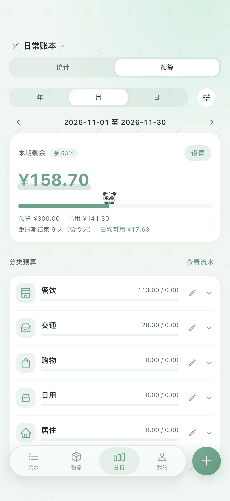

<p align="center"></p>
<h1 align="center">有数 YOUSHU</h1>
<p align="center"><strong>记清每一笔，也珍惜每一件。</strong></p>
<p align="center">本地优先的记账与物品管理 App</p>
<p align="center">Flutter · iOS / Android · SQLite · WebDAV · Apache-2.0</p>
<p align="center"><a href="#下载与体验">下载体验</a> · <a href="#功能一览">功能一览</a> · <a href="#从源码运行">从源码运行</a> · <a href="CONTRIBUTING.md">参与贡献</a> · <a href="https://youshu-site.894700104.xyz/">访问官网</a></p>

有数把日常收支、预算和生活中的物品放在一个 App 里。流水归流水，物品归物品：知道钱花在哪里，也能看到一件东西陪伴了多久、平均每天花了多少。

核心记账无需账号、无需自建服务器。数据保存在本机，你可以导出文件，也可以备份到自己的 WebDAV。

<table><tr><td width="33%"></td><td width="33%"></td><td width="33%"></td></tr><tr><td align="center">日常收支，一眼看清</td><td align="center">物品陪伴，心里有数</td><td align="center">预算进度，随时掌握</td></tr></table>

<p align="center">0.8.3 实际界面 · 橘猫喵账 / 滚滚熊猫主题</p>

## 下载与体验

| 平台 | 获取方式 | 说明 |
| --- | --- | --- |
| Android | [下载 APK](https://youshu-site.894700104.xyz/#download) | 官方下载入口；升级时保持相同签名 |
| iOS | App Store | 计划上架，下载链接尚未开放 |
| 开发者 | [从源码运行](#从源码运行) | 使用自己的开发环境与签名 |

更换安装来源前请先导出备份。自行构建版本与官方安装包可能使用不同签名，无法直接覆盖安装；自行构建默认关闭官方安装包更新通道。

## 功能一览

- **日常收支**：多账本、分类与标签、转账与退款，按列表、日历或月份回看。
- **预算与分析**：查看年、月、日预算和剩余金额，从统计进入具体流水。
- **账单迁移**：导入支付宝、微信及随手记支持的账单格式，先预览核对，再确认写入。
- **模板与周期计划**：复用常用记录，管理房租、房贷等周期事项，每期待确认。
- **独立物品管理**：照片、购买日期、维修养护、持有时长与日均成本，不计入记账流水和预算。
- **多种外观**：三套简约主题与六套手账主题，支持浅色、深色和字体调节。
- **原生小组件**：iOS WidgetKit 与 Android 桌面小组件读取应用在本机保存的摘要。

## 数据与备份

核心记录与计算在设备上完成，文件导出与恢复不依赖维护者提供的服务。

- 账本支持 CSV 导出、完整备份和副本恢复。
- 物品与照片独立存储、独立备份；**账本备份不包含物品和照片**。
- WebDAV 使用用户自行配置的 HTTPS 目录，凭据保存在系统安全存储中，不写入备份。
- 当前备份文件未提供内容加密，请放在可信位置。
- 参考汇率、主动配置的 WebDAV、外部链接和官方 Android 更新检查可能访问网络。

详见[使用说明](docs/user-guide.md)与[数据架构](docs/architecture.md)。

## 从源码运行

准备 Flutter 3.47.9 / Dart 3.13.7，以及目标平台的开发工具。Android 使用 JDK 17；iOS 需要 macOS 和 Xcode。

```sh
git clone https://github.com/SeafyLiang/youshu.git
cd youshu/apps/mobile
flutter pub get
flutter run
```

调试构建无需官方签名或服务端账号。iOS 真机需使用自己的开发团队、Bundle ID 和 App Group，具体见[开发指南](docs/development.md)。

验证客户端：

```sh
flutter analyze
flutter test --concurrency=2
```

## 代码结构

| 路径 | 内容 |
| --- | --- |
| `apps/mobile/lib` | 界面、领域规则与本地存储 |
| `apps/mobile/test` | 客户端测试与虚构样例 |
| `apps/mobile/ios` | iOS 应用与 WidgetKit |
| `apps/mobile/android` | Android 应用与桌面小组件 |
| `tests/fixtures` | 领域规则测试样例 |
| `docs` | 使用与开发说明 |
| `website` | 产品官网源码 |

当前核心功能离线运行，仓库不要求部署服务端。代码中保留了读取旧账本及历史状态的兼容逻辑。

## 参与贡献

欢迎从一个小问题开始：反馈使用体验、完善文档、补充测试，或者提交代码改进。

- [提交问题](https://github.com/SeafyLiang/youshu/issues)：附系统版本、App 版本、复现步骤和预期结果。
- [提出修改](https://github.com/SeafyLiang/youshu/pulls)：较大的功能请先开 Issue 讨论，小修复可以直接提交 PR。
- 适合入手的方向：文案与无障碍、虚构账单测试样例、备份恢复边界、不同屏幕的布局适配。

请先阅读[贡献指南](CONTRIBUTING.md)。不要在公开 Issue 中上传真实账单、访问令牌或 WebDAV 凭据；安全问题请按[安全报告说明](SECURITY.md)私下联系。

## 许可证与致谢

自有代码采用 [Apache License 2.0](LICENSE)。第三方依赖与素材继续遵循各自许可证，详见[第三方声明](THIRD_PARTY_NOTICES.md)。

感谢 Flutter 社区、Ant Design 图标与 Microsoft Fluent Emoji。代码许可证不授予以“有数 / YOUSHU”名义冒充官方发布的权利；第三方发行请清楚标识来源与维护者。

---

<p align="center">把生活记清楚，慢慢来，也有数。</p>
